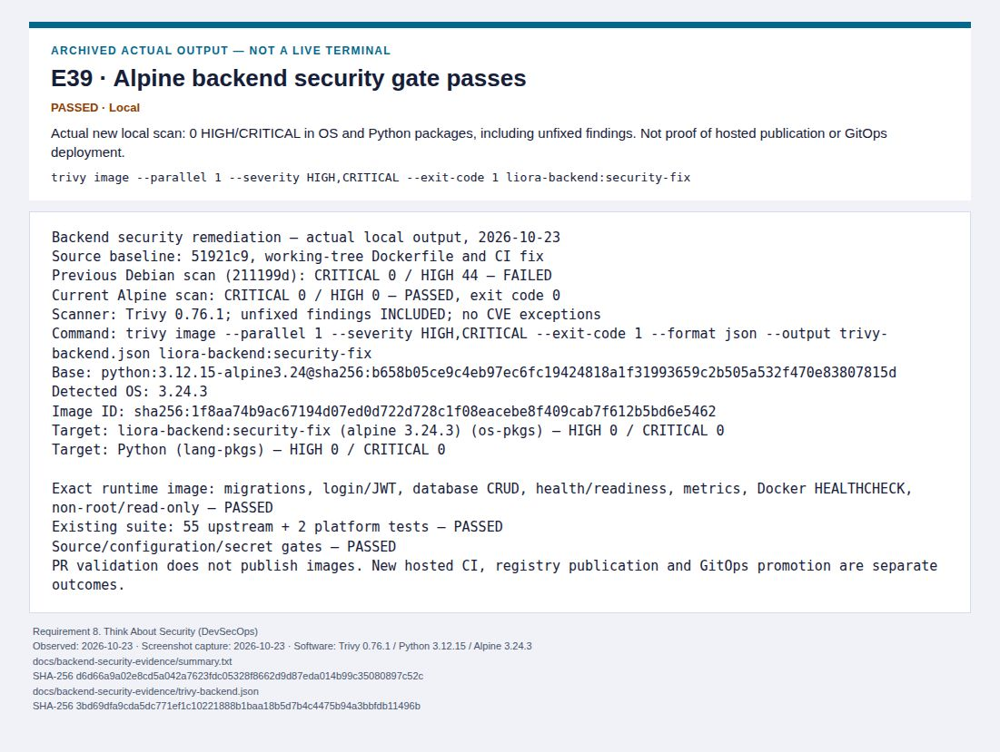
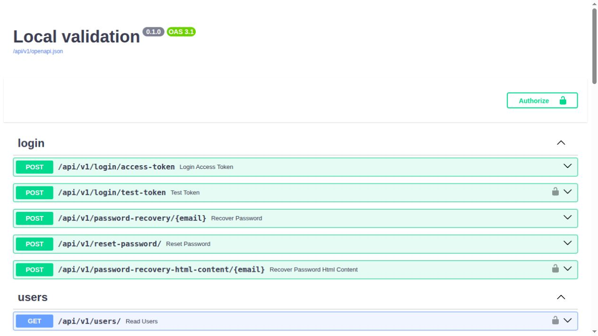
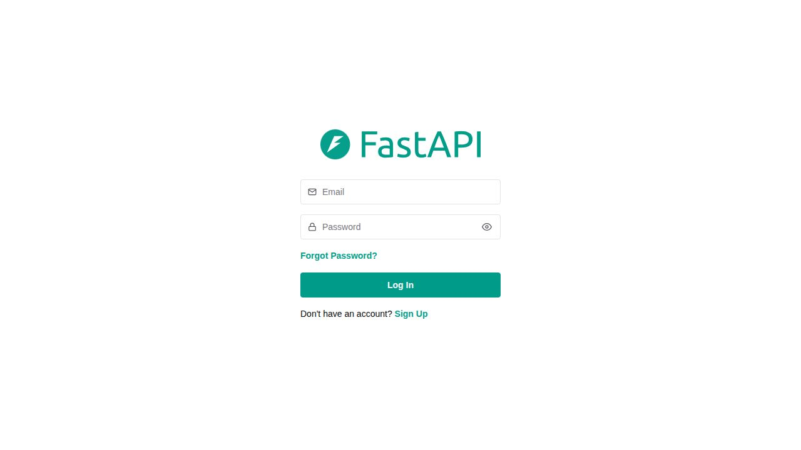
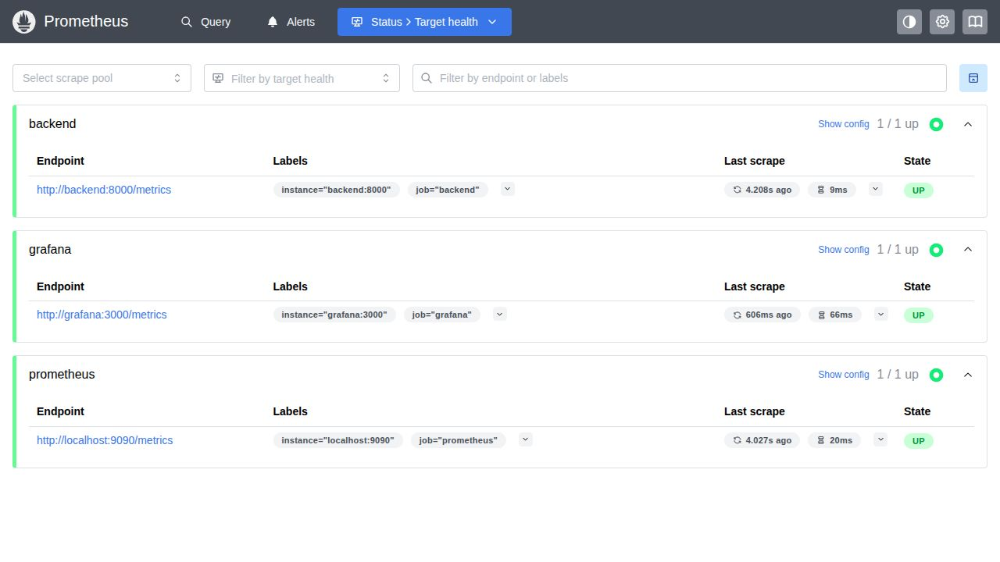
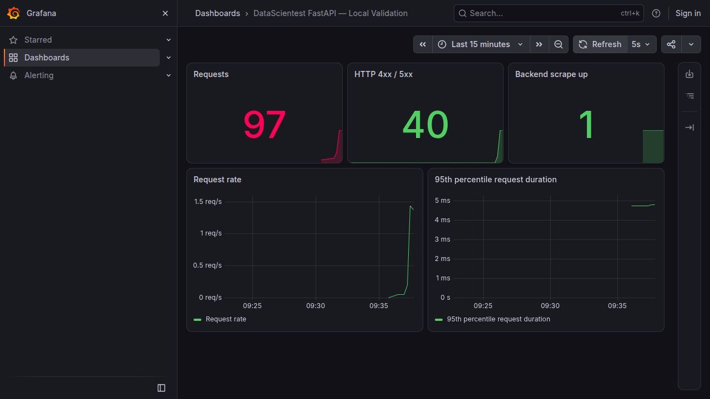
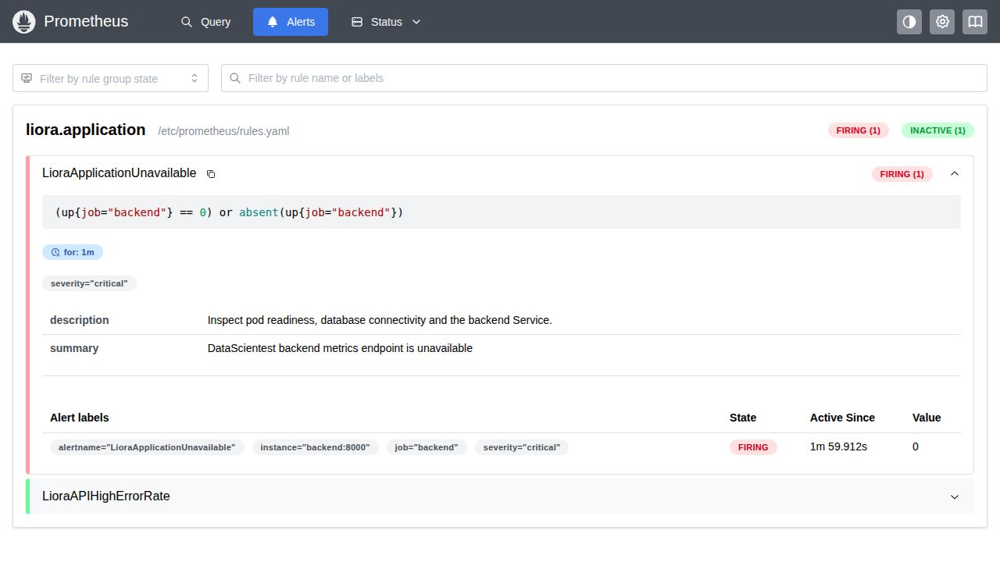

# Liora DevOps Platform

**End-to-end DevOps engineering around the existing [DataScientest FastAPI + Traefik project](https://github.com/DataScientest/fastapi-traefik-datascientest-project).** This repo is the course project's infrastructure and delivery layer, not a replacement web application.

> Status: Code-first infrastructure / Kubernetes / GitOps manifests are in development. No live Hetzner deployment has been performed.

See [second-pass validation and remaining blockers](docs/remediation-report.md) and the preserved [first-pass report](docs/local-validation-report.md).


## Graduation defense evidence

The [presentation evidence pack](docs/presentation-evidence.md) includes a ten-minute live plan and a ten-minute screenshot-only fallback under the exact ten official requirements. Browse [40 indexed screenshots](docs/screenshots/README.md), the [offline gallery](docs/presentation-evidence/index.html), the [validation checklist](docs/requirements-validation-checklist.md), and the [final compliance report](docs/final-compliance-report.md). Twelve images are actual application/GitHub/monitoring UIs; 28 are explicitly labeled views of real archived output, configuration or architecture. Five earlier screenshots are preserved unchanged.

Local authenticated item creation and a PostgreSQL 16 restore of that same record passed. Historical publication and Kubernetes evidence are dated separately. The [Alpine backend remediation](docs/backend-security-remediation.md) reduces the previous 44 HIGH Debian findings to **0 HIGH / 0 CRITICAL** in the strict local image scan. The exact runtime image also passes PostgreSQL migrations, login, authenticated item operations, readiness and metrics. Publication still requires successful CI and a push to main. The repository is now public; a new Argo public-repository sync/rollback has not been tested.



## Architecture

See [architecture diagram](docs/architecture.md): GitHub Actions CI tests the DataScientest FastAPI/PostgreSQL/React application, publishes backend/frontend SHA-tagged images to GHCR, updates the dev GitOps branch, and Argo CD reconciles k3s. Terraform provisions the future Hetzner host and firewall; Ansible bootstraps k3s. Prometheus and Grafana monitor the cluster.

## Tech stack

- **Application:** existing DataScientest FastAPI + React + PostgreSQL + Traefik, tracked in `course-app/` as an upstream Git submodule (MIT license).
- **CI:** GitHub Actions with upstream Ruff, pytest/PostgreSQL tests, container builds and GHCR.
- **CD:** Argo CD + Kustomize overlays, dev automatic, prod manual approval.
- **Infrastructure:** Terraform (Hetzner Cloud), Ansible (Ubuntu / pinned k3s).
- **Observability:** kube-prometheus-stack + Grafana, lightweight values for one node.
- **Security/DR:** restricted SSH firewall, GHCR private package credentials, namespace secrets, Trivy scan, etcd/SQL backups and rollback runbooks.

## Clone the real application

```bash
git clone --recurse-submodules https://github.com/dionis1/liora-devops-platform.git
cd liora-devops-platform
git submodule status
```

Already cloned? `git pull --ff-only && git submodule update --init --recursive`.

## Run the upstream app locally

These Compose commands use a pristine upstream checkout. For the reviewed patched platform images, use the preparation and build commands in the next section; the original Compose Dockerfiles target older Python dependencies.

```bash
cd course-app
docker compose build
docker compose up -d --wait backend frontend
```

Try http://localhost:5173 for React and http://localhost:8000/docs for FastAPI. This Compose configuration contains example local credentials. Do not expose it publicly without reconfiguration.

## Repository structure

```text
course-app/                       Upstream application submodule
.github/workflows/ci.yml          Tests, image builds, GHCR, dev promotion
.github/workflows/security.yml    Trivy source and configuration scan
.github/workflows/validate-platform.yml  Static Terraform/Ansible/Kustomize checks
infrastructure/terraform/         Single Hetzner server + firewall + private network
ansible/                           Server preparation and k3s installation
kubernetes/base/                  Backend, frontend, PostgreSQL, Ingress
kubernetes/overlays/dev/          Development namespace and image selection
kubernetes/overlays/prod/         Production namespace and image selection
gitops/applications.yaml          Argo CD applications
monitoring/                       Prometheus and Grafana chart values
scripts/                          Inventory, secret template, SQL backup
docs/                             Architecture, deployment and DR runbooks
```

## Before purchasing a server

CI applies the [reviewed integration patch](patches/README.md) to the pinned upstream application before building.
Build them sequentially from the repository root:

```bash
bash scripts/prepare-course-app.sh
docker build -f docker/backend.Dockerfile -t liora-backend:local course-app/backend
docker build -f docker/frontend.Dockerfile -t liora-frontend:local course-app/frontend
```

The backend runs as UID 10001 on port 8000; the frontend runs as UID 101 on
port 8080. Both define health checks. The Kubernetes frontend Service forwards
port 80 to container port 8080. Original upstream Compose files keep using
their original Dockerfiles. Source and published-image security gates must
pass before CI promotes dev; existing upstream dependency findings need
triage and updates before deployment.

Review [deferred deployment runbook](docs/deployment.md). Terraform will **not** execute automatically in CI and neither will Ansible installation. GitHub CI only validates and packages code. Hosted deployments start when you explicitly run the provisioning steps and supply your own credentials and DNS configuration.

## Recovery and limits

See [DR runbook](docs/disaster-recovery.md). One-node k3s is not HA; local PVCs have one failure domain, and disposable PostgreSQL restore drills do not prove recovery of a cloud server. TLS, live alert testing, durable off-site backup automation and hardening are additional gates before claiming real production readiness.


## Local validation screenshots

Captured on 2026-10-23 from real application and monitoring UIs. Monitoring used an isolated Docker fixture with synthetic requests to fit the laptop memory budget. These screenshots do not demonstrate a cloud deployment, authenticated UI login, or a new Kubernetes/Argo synchronization. See [scope and sources](docs/screenshots/manifest.json) and the [remediation report](docs/remediation-report.md).

### FastAPI Swagger UI

Real patched upstream API; no DB in screenshot fixture.



### React login page

Actual production frontend build; login form rendering, not an authenticated user session.



### Prometheus targets

All three isolated Docker targets UP, including Grafana.



### Grafana application dashboard

Synthetic local health requests and intentional 404s; not production traffic.



### Application unavailable firing

Disposable backend stopped; unchanged one-minute production alert rule evaluated by standalone Prometheus.


