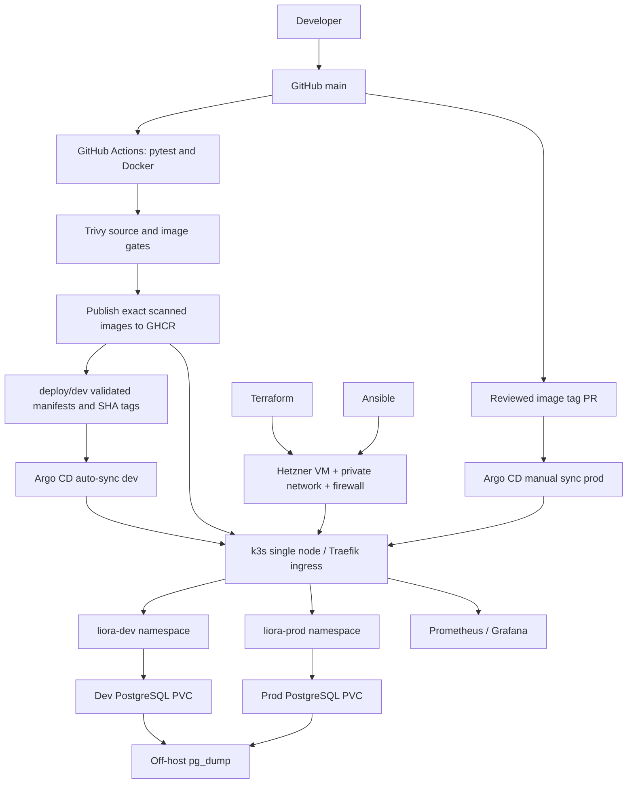

# Architecture and environment boundaries

This is a **single physical VM** lab: prod and dev are separated by Kubernetes namespaces and credentials, not by nodes or failure domains. PostgreSQL has one instance per namespace, backed by k3s local-path persistent volumes. There is **no node-level high availability**. The primary server is a single point of failure. Grafana and Argo CD stay on internal ClusterIP services accessed using a secure SSH tunnel and kubectl port-forward. Traefik is the k3s-provided ingress controller; the original application's Docker Compose Traefik setup is for local development only and must not be run simultaneously on the same ports in the k3s host.

## Responsibility split
- GitHub Actions: tests, lint, GHCR image release, dev image promotion to a Git branch; **no Kubernetes credentials**
- Argo CD: read-only GitOps reconciliation and deployment, automated for dev, manual for prod
- Terraform: create/recreate cloud VM, firewall, private network, SSH key
- Ansible: provision Ubuntu prerequisites and pinned k3s
- Kubernetes: deploy frontend, backend, database, Services, Ingress, namespace-scoped secrets
- Monitoring: kube-prometheus-stack for cluster and workload metrics; the reviewed platform patch exposes internal application metrics and database readiness
