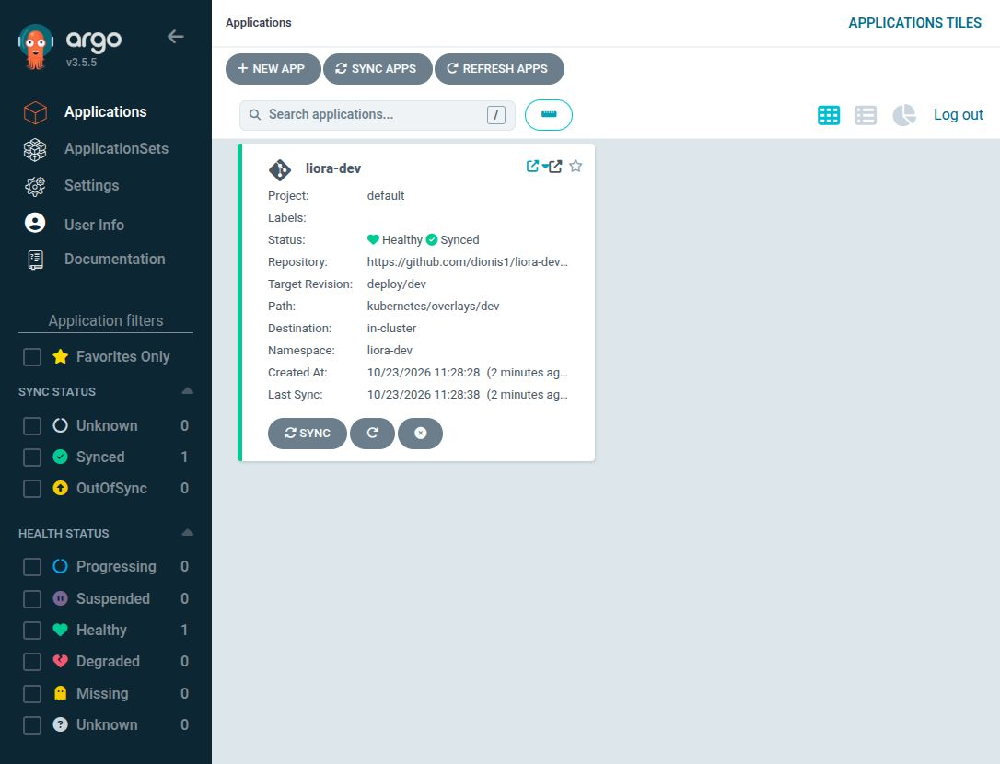
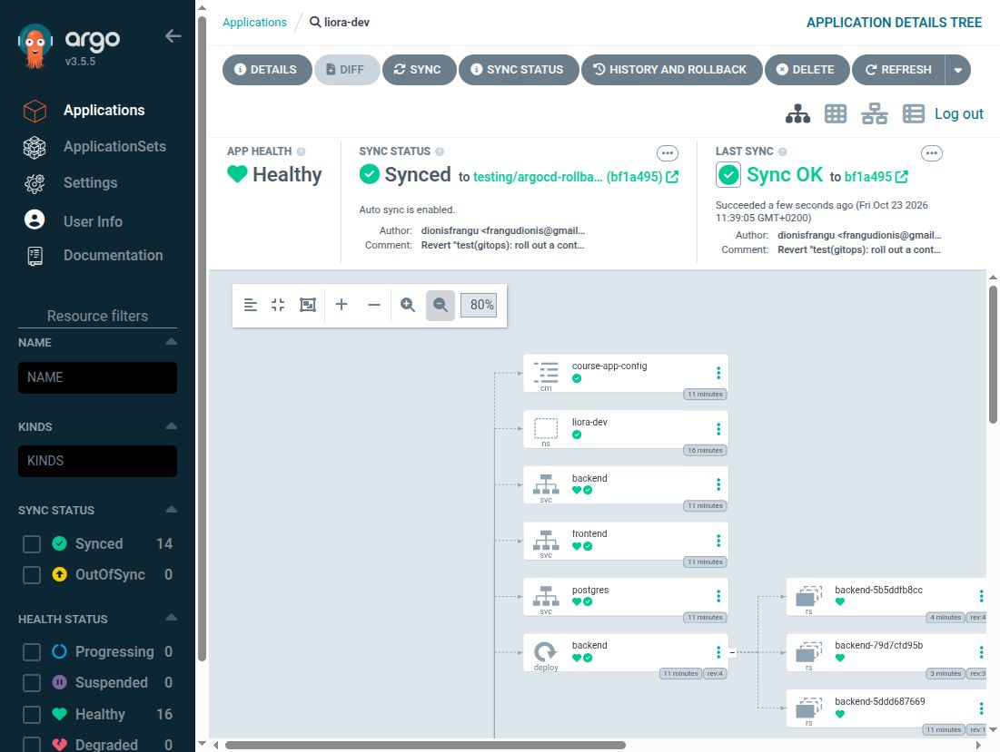

# Argo CD synchronization and GitOps rollback — 2026-10-23

**Local validation: PASSED.** The real `liora-dev` Application reached **Synced + Healthy**, with a **Succeeded** operation at the exact promoted Git revision. A subsequent Git revert restored the previous backend template and ReplicaSet, while the same database record remained accessible through Traefik. The disposable cluster was removed after evidence capture; this is not a permanently running or cloud deployment.

## 1. Dockerize Your Application

[Anonymous registry proof](argocd-evidence/registry-proof.json) and [actual running image IDs](argocd-evidence/running-images.json) match both published images. [Credential scope](argocd-evidence/credential-scope.json) records zero repository credential Secrets and zero registry credential Secrets. The application used only its separately generated local database/application Secret.

## 4. Container Orchestration with Kubernetes

Actual local results: one Ready node; backend, frontend and PostgreSQL pods all 1/1; ready Deployments and StatefulSet; 8 GiB PVC Bound; and Traefik routing to both frontend and authenticated API. The current non-root/read-only/drop-all/security-context manifests ran successfully. Application health, bcrypt login, JWT authentication and persisted item access passed after every rollout. [Readiness](argocd-evidence/ready-summary.txt) · [Functional result](argocd-evidence/functional-final-dev.txt).

Public deployments no longer reference a nonexistent `ghcr-pull` Secret. The removal was tested on the isolated branch. For private packages, add an explicit overlay reference to an externally managed read-only registry Secret; public Git visibility alone does not authorize a private package pull.

## 5. Automate Deployment (CI/CD Pipeline)

The repository and both GHCR packages are now public. These are separate access controls: the initial anonymous registry requests returned 401 even though GitHub source was public. After the package visibility change, both published SHA tags returned HTTP 200 without account credentials. A fresh k3d cluster pulled the images directly from GHCR; their running `imageID` digests exactly matched the registry responses. No local image import, repository deploy key or registry credential Secret was used.

The main release at `db2efa81c1037f3b38c4cc615fb7f65d958259c2` passed tests, lint, platform checks, strict image scans and **publication**. Its later **promotion job failed** because the old dev branch had changed image tags in a Kustomization that main had reformatted. The [original failure](argocd-evidence/promotion-failure.txt) and [workflow job records](argocd-evidence/release-jobs.json) are preserved; the overall run was not green.

The new [promotion script](../scripts/promote-dev.sh) merges the validated source and resolves that specific conflict only after proving the dev-side edits changed generated image tags alone. Other conflicts, including those involving manual manifest edits, fail closed, and the merge is aborted without discarding them. It requires a clean checkout and only pushes with `--push`. Three isolated Git regression tests cover the observed conflict, preservation/rejection of manual manifest edits, and first promotion. CI now runs those tests.

The reviewed script recovered the real promotion locally, using the already published/scanned main revision. The result is `deploy/dev` commit [`1b0ffd5`](https://github.com/dionis1/liora-devops-platform/commit/1b0ffd5c5dddbc88f5286d96e653858f2e525b20); compared with validated main, only its two image tags differ. [Recovery output](argocd-evidence/promotion-fixed.txt). The script's next hosted main-branch execution remains NOT YET TESTED until this fix is merged.

Argo used the canonical source configuration: public HTTPS URL, `deploy/dev`, `kubernetes/overlays/dev`, automatic sync, pruning and self-healing. The checker requires all of **Synced**, **Healthy**, **Succeeded**, the exact desired Git SHA and matching operation SHA, with no Application conditions. [Initial result](argocd-evidence/dev-sync.json) · [Final result after restoring deploy/dev](argocd-evidence/final-dev-sync.json).



## 9. Think About Disaster Recovery

The rollback drill used the real GitHub branch `testing/argocd-rollback-2026-10-23`, not a local substitute repository. Only the disposable Application followed that branch; the test marker changes never went into `deploy/dev` or production. Hard refreshes requested prompt comparison, after which Argo's automated policy applied the Git changes.

| Phase | Git revision | Backend template hash | Active ReplicaSet |
| --- | --- | --- | --- |
| Baseline | `1107506` | `529ae98d…842b4b` | `backend-5b5ddfb8cc` |
| Controlled template change | `0c279d4` | `ae3a9c73…c4aa6` | `backend-79d7cfd95b` |
| Git revert | `bf1a495` | `529ae98d…842b4b` | `backend-5b5ddfb8cc` |

Every revision reached Synced + Healthy with a successful operation and ready deployment. The full template hashes and ReplicaSet counts prove restoration; the changed ReplicaSet scaled to zero. The synthetic item `7d879341-88f9-4049-9c20-3b589306b40d` / “GitOps rollback continuity record” was read successfully after the baseline, changed rollout, revert and final return to `deploy/dev`.

This proves **deployment-configuration rollback** through Git and Argo. The secure image tag stayed `sha-db2efa81c1037f3b38c4cc615fb7f65d958259c2`; image-version downgrade and database-schema rollback were not tested. Git revert is compatible with automatic reconciliation; Argo's native rollback operation cannot be used while auto-sync is enabled. [Official auto-sync documentation](https://argo-cd.readthedocs.io/en/stable/user-guide/auto_sync/).

[Full rollback proof](argocd-evidence/rollback-proof.txt) · [Baseline snapshot](argocd-evidence/snapshot-baseline.json) · [Changed snapshot](argocd-evidence/snapshot-changed.json) · [Reverted snapshot](argocd-evidence/snapshot-reverted.json).



## Repeatable local setup and limits

Versions: k3d 5.9.0, k3s 1.35.5-k3s1, Helm chart 10.10.5, Argo CD 3.5.5, PostgreSQL 16.10. The node had a 2 GiB memory cap; monitoring was not started. The test started above a measured 1500 MiB available-memory gate and monitored memory continuously, with an abort for sustained availability below 384 MiB. [Memory summary](argocd-evidence/memory-summary.json).

Use only an explicitly selected disposable kubeconfig. The [local Helm values](../gitops/argocd-local-values.yaml) disable unused components and bound memory. Chart 10.10.5 needs `applicationSet.replicas: 0`; an `applicationSet.enabled` value has no effect. The HTTP Argo server is a ClusterIP, accessed only by a loopback port-forward.

```bash
helm --kubeconfig "$VALIDATION_KUBECONFIG" upgrade --install argocd argo-cd \
  --repo https://argoproj.github.io/argo-helm --version 10.10.5 \
  -n argocd --create-namespace -f gitops/argocd-local-values.yaml --wait
kubectl --kubeconfig "$VALIDATION_KUBECONFIG" -n argocd \
  port-forward --address 127.0.0.1 service/argocd-server 18082:80
python3 scripts/check-argocd-sync.py --kubeconfig "$VALIDATION_KUBECONFIG" \
  --application liora-dev --revision FULL_EXPECTED_GIT_SHA
```

Before synchronizing, create the namespace application Secret locally and confirm that dev references real published tags. Do not apply both dev and prod Applications just to run this local test: production was not deployed. The production manifest still has **no automated sync policy**, verified statically in [the policy record](argocd-evidence/production-manual-policy.json).

Remaining work: hosted execution of the new promotion helper after merge; production/manual-sync deployment; public DNS/TLS; Hetzner provisioning; negative NetworkPolicy tests; image-version/schema rollback; and actual embedded-etcd/off-site/replacement-host recovery. No production or cloud success is inferred from this local validation.

## Final checks and cleanup

[Focused checks](argocd-evidence/validation-summary.txt), [three promotion regressions](argocd-evidence/promotion-tests.txt), [Kubernetes scan](argocd-evidence/kubernetes-security.txt), [evidence secret scan](argocd-evidence/evidence-secret-scan.txt) and [artifact checksums](argocd-evidence/checksums.json) are preserved. [Cleanup audit](argocd-evidence/cleanup-audit.json) confirms the owned cluster and generated credentials were removed while the existing applications and stopped clusters were preserved. The isolated rollback branch remains in GitHub for reviewable provenance.
