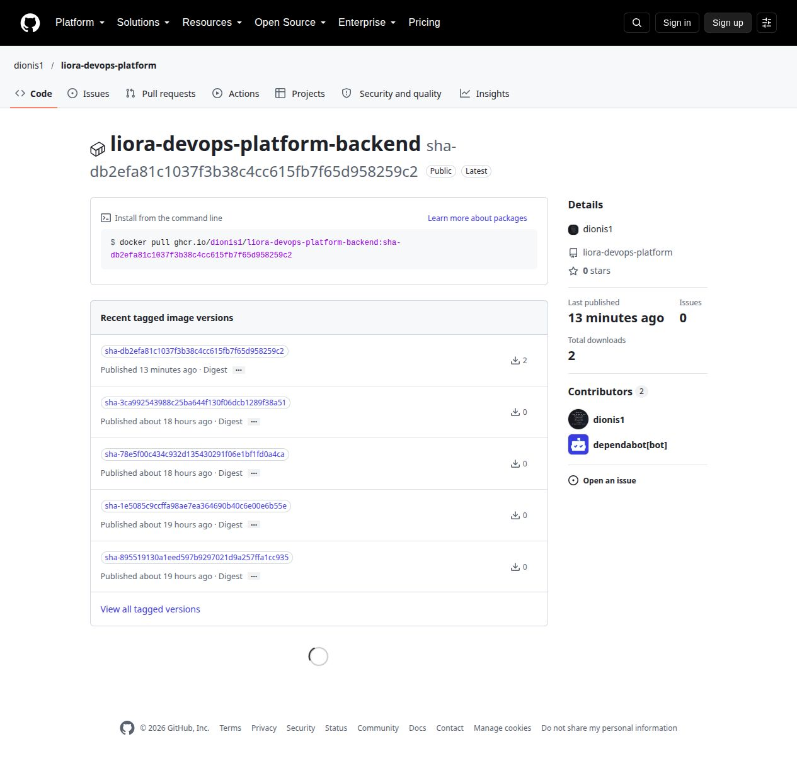
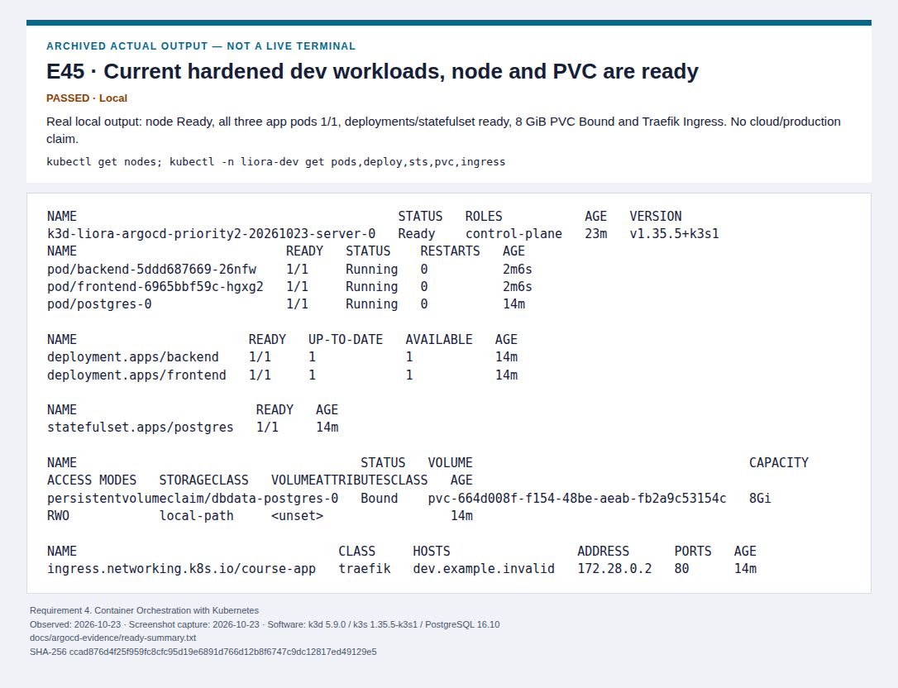
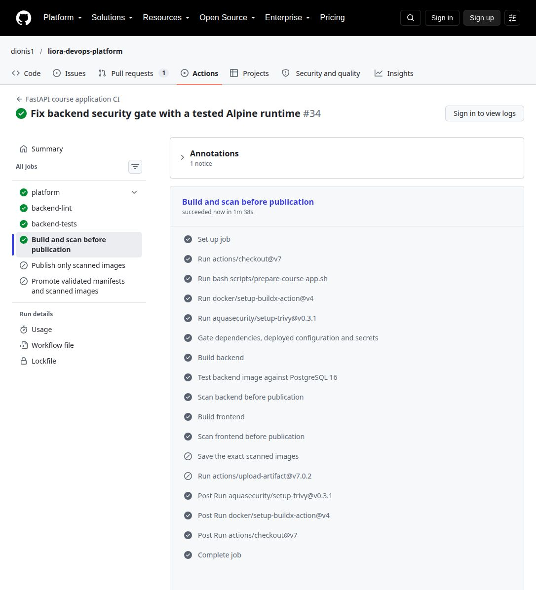

# Graduation presentation evidence

**51 screenshots, covering all ten official requirements:** 21 actual UI captures and 30 clearly labeled views of real saved output/configuration/design. Five earlier UI screenshots are reused unchanged. Captures are dated 2026-10-23; original historical observations retain their dates.

Open [the offline gallery](presentation-evidence/index.html), [the complete evidence index](screenshots/README.md), [the validation checklist](requirements-validation-checklist.md) and [the final compliance report](final-compliance-report.md). Keep docs/screenshots and docs/presentation-evidence together; the gallery has no external dependencies.

**State to say aloud:** “The secure application images were published and pulled from GHCR. The real local Argo Application reached Synced and Healthy, and Git revert restored the previous backend configuration while preserving data. The main promotion initially hit a merge conflict and was recovered with a guarded script. Its next hosted execution, production, public TLS and cloud/full recovery still need validation.”

## Ten-minute live demonstration plan

Use only services already running safely. Do not start monitoring alongside Kubernetes/Argo on this laptop. The validation cluster was cleaned up; use its named screenshots unless a fresh demo has already been prepared. If a page fails, switch immediately to the fallback instead of troubleshooting during the timed defense. These commands inspect existing resources; they do not provision or restore production.

| Time | Explain to the examiner | Live command/page | Screenshot fallback | DevOps skill demonstrated |
| --- | --- | --- | --- | --- |
| 0:00–1:30 | Architecture, original app attribution, IaC boundaries and rubric (6, 10). | Architecture.md; saved Terraform and Ansible results. | E36, E24, E25 | Reviewed infrastructure code and clear scope. |
| 1:30–2:30 | Docker, public GHCR tag and matching running digest (1). | Public package page; saved registry-proof.json and running-images.json. | E49, E51, E07 | Tested image publication, access and runtime identity. |
| 2:30–4:00 | Tests, strict scans, successful publication and diagnosed promotion failure (3, 5). | [Passing fix CI](https://github.com/dionis1/liora-devops-platform/actions/runs/39928939273); [real publication job](https://github.com/dionis1/liora-devops-platform/actions/runs/39931016209/job/120340274170); promotion tests. | E16, E41, E50 | Enforced gates and guarded Git promotion. |
| 4:00–5:15 | Current dev workloads, PVC, routing and prod separation (2, 4). | With an explicit prepared context: kubectl -n liora-dev get pods,deploy,sts,pvc,ingress. | E45, E19 | Actual orchestration, storage and application routing. |
| 5:15–6:00 | Exact-revision Argo Synced + Healthy; prod manual policy (5). | Existing local Argo UI or saved exact-revision checks; gitops/applications.yaml. | E43, E44, E23 | Reconciliation proof, distinct from server health. |
| 6:00–7:15 | Real metrics, healthy targets and alert lifecycle (7). | Existing isolated Grafana/Prometheus only; otherwise evidence. | E03, E04, E05, E26 | Instrumentation and tested alert evaluation/recovery. |
| 7:15–8:45 | Security before/after and actual hardened pods (8). | Scan summaries; source/image gates; rendered security contexts. | E39, E41, E45, E29 | Risk reduction and honest enforcement boundaries. |
| 8:45–10:00 | Fresh SQL restore plus verified GitOps configuration rollback (9). | Saved rollback-proof.txt, snapshots and PostgreSQL restore rows. | E47, E48, E34 | Recovery proof and configuration/schema scope limits. |

## Ten-minute screenshot-only fallback

Use one minute per official requirement, in this exact order. All screenshots work from the offline gallery.

| Time | Official requirement | Show | Say and qualify |
| --- | --- | --- | --- |
| 0:00–1:00 | 1. Dockerize Your Application | [E49: Public GHCR package exposes the secure release tag](screenshots/01-dockerize-your-application/E49.jpg), [E51: Anonymous registry reads match the actual running image digests](screenshots/01-dockerize-your-application/E51.jpg) | Real images were published and pulled; registry digests match running pods. Public Git and package access were checked separately. |
| 1:00–2:00 | 2. Deploy the Application in Multiple Environments (Dev & Prod) | [E45: Current hardened dev workloads, node and PVC are ready](screenshots/04-container-orchestration-with-kubernetes/E45.jpg), [E43: Argo development Application is Synced and Healthy](screenshots/05-automate-deployment-ci-cd-pipeline/E43.jpg) | Current hardened local dev passed; prod is separated in configuration and remains undeployed. |
| 2:00–3:00 | 3. Run Tests on the Application | [E16: 55 upstream tests passed](screenshots/03-run-tests-on-the-application/E16.jpg), [E17: Platform metrics and readiness tests passed](screenshots/03-run-tests-on-the-application/E17.jpg) | 55 upstream plus 2 platform tests and actual image integration passed; 3 new Git promotion regressions passed. Full browser E2E/client regeneration remains untested. |
| 3:00–4:00 | 4. Container Orchestration with Kubernetes | [E45: Current hardened dev workloads, node and PVC are ready](screenshots/04-container-orchestration-with-kubernetes/E45.jpg), [E44: Canonical dev branch restored after successful rollback test](screenshots/05-automate-deployment-ci-cd-pipeline/E44.jpg) | Ready local node, three ready pods, 8 GiB PVC, ingress and rollouts are real. The temporary cluster was removed; no cloud deployment is claimed. |
| 4:00–5:00 | 5. Automate Deployment (CI/CD Pipeline) | [E43: Argo development Application is Synced and Healthy](screenshots/05-automate-deployment-ci-cd-pipeline/E43.jpg), [E44: Canonical dev branch restored after successful rollback test](screenshots/05-automate-deployment-ci-cd-pipeline/E44.jpg) | Argo Synced/Healthy and real publication passed. Promotion initially failed and was recovered locally; the durable helper still needs hosted main execution. |
| 5:00–6:00 | 6. Create IaC (Infrastructure as Code) Templates | [E24: Terraform formatting and validation passed](screenshots/06-create-iac-infrastructure-as-code-templates/E24.jpg), [E25: Three Ansible syntax checks passed](screenshots/06-create-iac-infrastructure-as-code-templates/E25.jpg) | Templates and syntax validate; no cloud plan/apply, provisioning or host replacement was executed. |
| 6:00–7:00 | 7. Monitor the Application | [E03: All three Prometheus targets UP](screenshots/07-monitor-the-application/prometheus-targets-up.jpg), [E04: Real request counts, error counts and latency](screenshots/07-monitor-the-application/grafana-request-latency-errors.jpg) | Synthetic metrics and unavailable-alert firing/recovery passed; Kubernetes ServiceMonitor discovery and notification delivery remain untested. |
| 7:00–8:00 | 8. Think About Security (DevSecOps) | [E41: Hosted backend image security gate passes](screenshots/08-think-about-security-devsecops/E41.jpg), [E39: Alpine backend security gate passes](screenshots/08-think-about-security-devsecops/E39.jpg) | Strict backend findings reached zero HIGH/CRITICAL and hardened pods ran. Negative NetworkPolicy enforcement and production TLS remain untested. |
| 8:00–9:00 | 9. Think About Disaster Recovery | [E47: Git revert restores a healthy backend deployment](screenshots/09-think-about-disaster-recovery/E47.jpg), [E48: Argo history records changed revision and Git revert](screenshots/09-think-about-disaster-recovery/E48.jpg) | A fresh SQL restore matched data. Git revert restored the exact backend template/ReplicaSet and preserved a record; image/schema downgrade and cloud/etcd recovery were not tested. |
| 9:00–10:00 | 10. Documentation | [E36: Architecture and engineering boundaries](screenshots/10-documentation/E36.jpg) | Exact rubric, provenance, dated failures/successes, offline gallery and both ten-minute schedules make the project reviewable. |

## Evidence for the ten official requirements

### 1. Dockerize Your Application

**Assessment: PASSED**

**Implemented:** Multi-stage, non-root platform images around the original pinned DataScientest application; digest-pinned Alpine backend, health checks and a reviewed dependency patch.

**How it was tested:** Sequential builds and authenticated application tests passed. Secure release db2efa8 was published to GHCR; both public SHA tags returned anonymous HTTP 200 and their digests matched actual running Kubernetes pods. Frontend and authenticated API routing through Traefik passed.

**Evidence:** [E49: Public GHCR package exposes the secure release tag](screenshots/01-dockerize-your-application/E49.jpg), [E51: Anonymous registry reads match the actual running image digests](screenshots/01-dockerize-your-application/E51.jpg), [E07: Browser-created item persists after reload](screenshots/01-dockerize-your-application/item-created-and-persisted.jpg), [E08: Executed Swagger request returns HTTP 200](screenshots/01-dockerize-your-application/swagger-real-health-200.jpg), [E13: Backend image build completed](screenshots/01-dockerize-your-application/E13.jpg), [E14: Frontend TypeScript and production bundle completed](screenshots/01-dockerize-your-application/E14.jpg), [E15: Running containers and health checks](screenshots/01-dockerize-your-application/E15.jpg), [E10: Historical successful GHCR publication and dev promotion](screenshots/05-automate-deployment-ci-cd-pipeline/github-historical-publish-promote.jpg), [E40: Exact Alpine image passes PostgreSQL integration checks](screenshots/08-think-about-security-devsecops/E40.jpg), [E41: Hosted backend image security gate passes](screenshots/08-think-about-security-devsecops/E41.jpg), [E50: Secure image publication succeeds; promotion initially fails](screenshots/05-automate-deployment-ci-cd-pipeline/E50.jpg).

**What to explain:** I can package an existing application reproducibly and validate the complete UI–API–database path.

**Limit:** No Docker/registry blocker remains for tested release db2efa8. Production/cloud availability and public ingress/TLS remain separate untested work.

### 2. Deploy the Application in Multiple Environments (Dev & Prod)

**Assessment: PARTIALLY VALIDATED**

**Implemented:** Separate dev/prod namespaces, overlays, host settings, credentials references and a production TLS Secret reference.

**How it was tested:** Both overlays render. Current hardened dev workloads were actually synchronized by Argo from public GitHub and pulled the secure release from GHCR; Traefik routing, authentication and database item access passed. Production remains static configuration only.

**Evidence:** [E45: Current hardened dev workloads, node and PVC are ready](screenshots/04-container-orchestration-with-kubernetes/E45.jpg), [E43: Argo development Application is Synced and Healthy](screenshots/05-automate-deployment-ci-cd-pipeline/E43.jpg), [E19: Dev and prod separation: static manifests](screenshots/02-deploy-the-application-in-multiple-environments-dev-prod/E19.jpg), [E20: Historical dev pods and Services READY](screenshots/04-container-orchestration-with-kubernetes/E20.jpg), [E21: Historical PVC and Kubernetes HTTP access](screenshots/04-container-orchestration-with-kubernetes/E21.jpg).

**What to explain:** I separate configuration and release policies while being explicit about shared-node failure domains.

**Limit:** Production deployment and public TLS are NOT YET TESTED. The successful dev deployment was a disposable local validation, not a running Hetzner service.

### 3. Run Tests on the Application

**Assessment: PASSED**

**Implemented:** Upstream tests, PostgreSQL migrations, mypy/Ruff, and metrics/readiness checks run in CI.

**How it was tested:** 55 upstream tests and 2 platform tests pass; exact CI script passes locally and hosted backend-tests/lint jobs passed at 211199d. New browser login/create/reload smoke passed.

**Evidence:** [E16: 55 upstream tests passed](screenshots/03-run-tests-on-the-application/E16.jpg), [E17: Platform metrics and readiness tests passed](screenshots/03-run-tests-on-the-application/E17.jpg), [E18: Mypy and Ruff passed](screenshots/03-run-tests-on-the-application/E18.jpg), [E09: Historical Debian CI blocks publication](screenshots/05-automate-deployment-ci-cd-pipeline/github-current-security-gate.jpg), [E07: Browser-created item persists after reload](screenshots/01-dockerize-your-application/item-created-and-persisted.jpg), [E40: Exact Alpine image passes PostgreSQL integration checks](screenshots/08-think-about-security-devsecops/E40.jpg), [E41: Hosted backend image security gate passes](screenshots/08-think-about-security-devsecops/E41.jpg).

**What to explain:** I use automated checks and a focused functional smoke test to catch compatibility regressions.

**Limit:** The complete automated browser E2E suite and OpenAPI-client regeneration are NOT YET TESTED.

### 4. Container Orchestration with Kubernetes

**Assessment: PARTIALLY VALIDATED**

**Implemented:** Deployments, StatefulSet, PVC, Services, ConfigMap, Ingress, namespace policy and resource/security settings.

**How it was tested:** Current hardened dev: Ready k3s node, all three pods 1/1, Deployments/StatefulSet ready, 8 GiB PVC Bound, healthy Ingress, authenticated Traefik routing, real image pulls, Argo reconciliation and Git-revert rollout passed.

**Evidence:** [E45: Current hardened dev workloads, node and PVC are ready](screenshots/04-container-orchestration-with-kubernetes/E45.jpg), [E44: Canonical dev branch restored after successful rollback test](screenshots/05-automate-deployment-ci-cd-pipeline/E44.jpg), [E20: Historical dev pods and Services READY](screenshots/04-container-orchestration-with-kubernetes/E20.jpg), [E21: Historical PVC and Kubernetes HTTP access](screenshots/04-container-orchestration-with-kubernetes/E21.jpg), [E37: Historical ConfigMap, Ingress and rollout results](screenshots/04-container-orchestration-with-kubernetes/E37.jpg), [E19: Dev and prod separation: static manifests](screenshots/02-deploy-the-application-in-multiple-environments-dev-prod/E19.jpg).

**What to explain:** I translate application dependencies into orchestrated resources and verify readiness, storage and routing.

**Limit:** Hetzner-hosted orchestration, production deployment and negative NetworkPolicy enforcement tests are NOT YET TESTED. The local cluster was removed after evidence capture.

### 5. Automate Deployment (CI/CD Pipeline)

**Assessment: PARTIALLY VALIDATED**

**Implemented:** Tests/build/strict-scan gates, exact-scanned-image publication, guarded dev promotion, automatic Argo dev reconciliation and manual production sync policy.

**How it was tested:** Main db2efa8 passed scans and publication; its promotion failed on a generated-tag merge conflict. The reviewed helper recovered real deploy/dev at 1b0ffd5 and three Git regression tests passed. Argo reached exact-revision Synced/Healthy/Succeeded from public GitHub with real GHCR images; an isolated Git revert restored the prior template and ReplicaSet.

**Evidence:** [E43: Argo development Application is Synced and Healthy](screenshots/05-automate-deployment-ci-cd-pipeline/E43.jpg), [E44: Canonical dev branch restored after successful rollback test](screenshots/05-automate-deployment-ci-cd-pipeline/E44.jpg), [E50: Secure image publication succeeds; promotion initially fails](screenshots/05-automate-deployment-ci-cd-pipeline/E50.jpg), [E46: Argo rolls out the controlled changed Git revision](screenshots/05-automate-deployment-ci-cd-pipeline/E46.jpg), [E42: Complete Alpine fix CI workflow succeeds](screenshots/05-automate-deployment-ci-cd-pipeline/E42.jpg), [E09: Historical Debian CI blocks publication](screenshots/05-automate-deployment-ci-cd-pipeline/github-current-security-gate.jpg), [E10: Historical successful GHCR publication and dev promotion](screenshots/05-automate-deployment-ci-cd-pipeline/github-historical-publish-promote.jpg), [E22: Argo CD ran, but private repository comparison failed](screenshots/05-automate-deployment-ci-cd-pipeline/E22.jpg), [E23: Production manual sync configuration](screenshots/05-automate-deployment-ci-cd-pipeline/E23.jpg), [E38: Historical Argo components ready; sync still unproven](screenshots/05-automate-deployment-ci-cd-pipeline/E38.jpg), [E39: Alpine backend security gate passes](screenshots/08-think-about-security-devsecops/E39.jpg).

**What to explain:** I design a delivery chain that blocks unsafe releases and keep Git promotion distinct from successful deployment.

**Limit:** The new promotion helper still needs its first hosted main-branch execution after merge. Production manual-sync policy passed static review; production deployment/manual synchronization is NOT YET TESTED. The historical main run remains failed at promotion; local recovery is documented separately.

### 6. Create IaC (Infrastructure as Code) Templates

**Assessment: PARTIALLY VALIDATED**

**Implemented:** Terraform Hetzner templates and Ansible preparation/k3s/kubeconfig playbooks, with restricted SSH configuration.

**How it was tested:** Fresh Terraform fmt/validate and three Ansible syntax checks passed; hosted platform validation passed.

**Evidence:** [E24: Terraform formatting and validation passed](screenshots/06-create-iac-infrastructure-as-code-templates/E24.jpg), [E25: Three Ansible syntax checks passed](screenshots/06-create-iac-infrastructure-as-code-templates/E25.jpg), [E11: Current Terraform, Ansible and Kustomize workflow passes](screenshots/06-create-iac-infrastructure-as-code-templates/github-platform-validation-passed.jpg).

**What to explain:** I express infrastructure as reviewed code and validate it before any billable provisioning.

**Limit:** Terraform plan/apply, actual remote provisioning and server recreation are NOT YET TESTED. No Hetzner API resources were created.

### 7. Monitor the Application

**Assessment: PARTIALLY VALIDATED**

**Implemented:** Prometheus/Grafana resources, FastAPI metrics, dashboard, ServiceMonitor and unavailable/5xx alert rules.

**How it was tested:** All three isolated targets were UP including Grafana; real synthetic request/rate/latency/error metrics rendered; the one-minute unavailable alert fired and cleared after recovery.

**Evidence:** [E03: All three Prometheus targets UP](screenshots/07-monitor-the-application/prometheus-targets-up.jpg), [E04: Real request counts, error counts and latency](screenshots/07-monitor-the-application/grafana-request-latency-errors.jpg), [E05: Unavailable alert FIRING after one minute](screenshots/07-monitor-the-application/application-alert-firing.jpg), [E26: Application alert cleared after recovery](screenshots/07-monitor-the-application/E26.jpg), [E27: ServiceMonitor implemented: runtime discovery pending](screenshots/07-monitor-the-application/E27.jpg).

**What to explain:** I instrument service behavior and validate alert evaluation rather than equating process uptime with observability.

**Limit:** The new ServiceMonitor discovery in Kubernetes, receiver delivery, sustained 5xx alert scenario and durable monitoring recovery are NOT YET TESTED.

### 8. Think About Security (DevSecOps)

**Assessment: PARTIALLY VALIDATED**

**Implemented:** Dependency remediation, strict source/image gates, non-root/read-only controls, dropped capabilities, NetworkPolicies and safe temporary credential cleanup.

**How it was tested:** Backend reached 0 HIGH/CRITICAL locally and passed hosted strict image scanning at db2efa8 before publication. Source/configuration gates passed. Current non-root/read-only/drop-all Kubernetes workloads ran successfully. Public Git/GHCR needed no repository or registry credential; obsolete public imagePullSecrets references were removed and tested on the isolated branch.

**Evidence:** [E41: Hosted backend image security gate passes](screenshots/08-think-about-security-devsecops/E41.jpg), [E39: Alpine backend security gate passes](screenshots/08-think-about-security-devsecops/E39.jpg), [E45: Current hardened dev workloads, node and PVC are ready](screenshots/04-container-orchestration-with-kubernetes/E45.jpg), [E51: Anonymous registry reads match the actual running image digests](screenshots/01-dockerize-your-application/E51.jpg), [E28: Security before and after remediation](screenshots/08-think-about-security-devsecops/E28.jpg), [E29: Historical Debian security gate fails closed](screenshots/08-think-about-security-devsecops/E29.jpg), [E12: Current source security workflow passes](screenshots/08-think-about-security-devsecops/github-source-security-passed.jpg), [E30: Container security controls configured](screenshots/08-think-about-security-devsecops/E30.jpg), [E31: Default-deny policy and explicit database traffic](screenshots/08-think-about-security-devsecops/E31.jpg), [E32: Temporary credential access removed](screenshots/08-think-about-security-devsecops/E32.jpg), [E40: Exact Alpine image passes PostgreSQL integration checks](screenshots/08-think-about-security-devsecops/E40.jpg).

**What to explain:** I quantify security improvement, keep failing policy checks enabled, and distinguish configuration from enforcement.

**Limit:** Negative-path Kubernetes NetworkPolicy enforcement and production security/TLS are NOT YET TESTED. Public Git/GHCR reads are verified independently; the previous temporary account SSH key remains removed.

### 9. Think About Disaster Recovery

**Assessment: PARTIALLY VALIDATED**

**Implemented:** Atomic compressed PostgreSQL backups, recovery/rollback runbooks and off-node snapshot/token guidance.

**How it was tested:** PG16 backup/restore and failed-dump cleanup previously passed. A real public-GitHub controlled rollout followed by Git revert returned Argo to Synced/Healthy, restored the exact backend template hash and ReplicaSet, and preserved the same API/database record after both rollouts.

**Evidence:** [E47: Git revert restores a healthy backend deployment](screenshots/09-think-about-disaster-recovery/E47.jpg), [E48: Argo history records changed revision and Git revert](screenshots/09-think-about-disaster-recovery/E48.jpg), [E34: Restored record matches the browser-created item](screenshots/09-think-about-disaster-recovery/E34.jpg), [E33: Actual backup creation and mode 0600](screenshots/09-think-about-disaster-recovery/E33.jpg), [E35: Failed backups leave no completed corrupt archive](screenshots/09-think-about-disaster-recovery/E35.jpg), [E07: Browser-created item persists after reload](screenshots/01-dockerize-your-application/item-created-and-persisted.jpg).

**What to explain:** I prove recovery with restored data and failure-path checks while stating the boundary of the drill.

**Limit:** Image-version/schema downgrade, actual k3s snapshot/restore, off-site durability and replacement-server/cloud recovery are NOT YET TESTED. The earlier database backup used its documented kubectl-to-Docker adapter; the new GitOps rollback used real Kubernetes and Argo.

### 10. Documentation

**Assessment: PASSED**

**Implemented:** Architecture/runbooks, exact ten-heading compliance mapping, provenance-backed screenshot index, capture protocol and both ten-minute plans.

**How it was tested:** Screenshot/source hashes, original-image preservation, asset links and offline presentation gallery are checked before delivery.

**Evidence:** [E36: Architecture and engineering boundaries](screenshots/10-documentation/E36.jpg).

**What to explain:** I make the system reviewable and explain its tested capabilities and remaining risks precisely.

**Limit:** The architecture is a design view; future cloud boxes are not deployment evidence. This is an evidence pack, not an exported PowerPoint deck.

The two schedules each total 600 seconds. The full application, monitoring and Argo stacks are separate resource-sensitive phases. [Capture protocol](screenshots/capture-protocol.md) · [Remaining gaps](presentation-evidence/missing-evidence.md).
