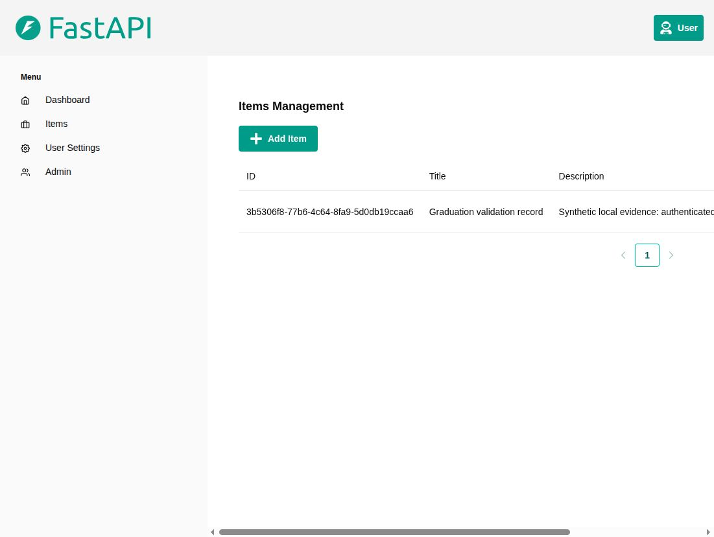
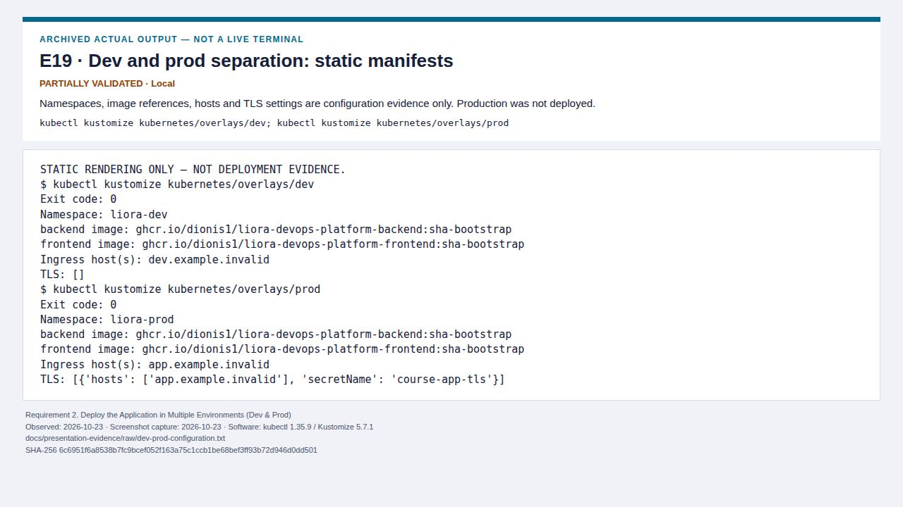
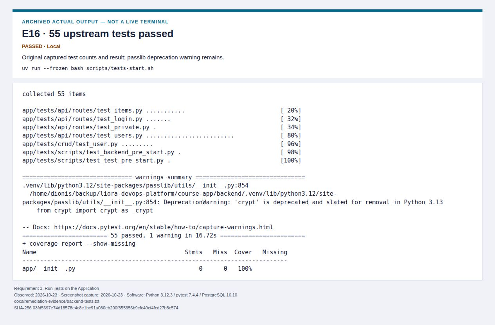
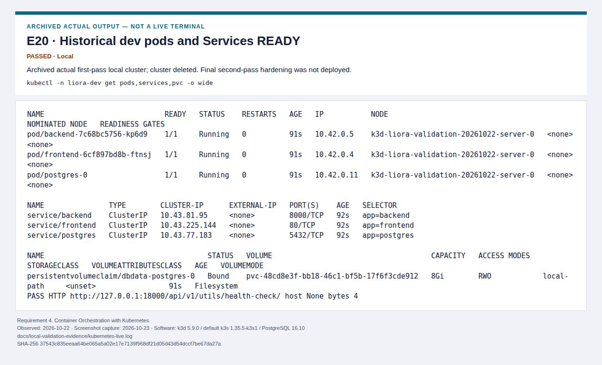
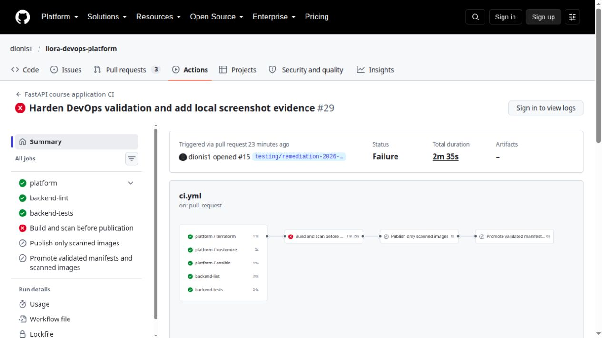
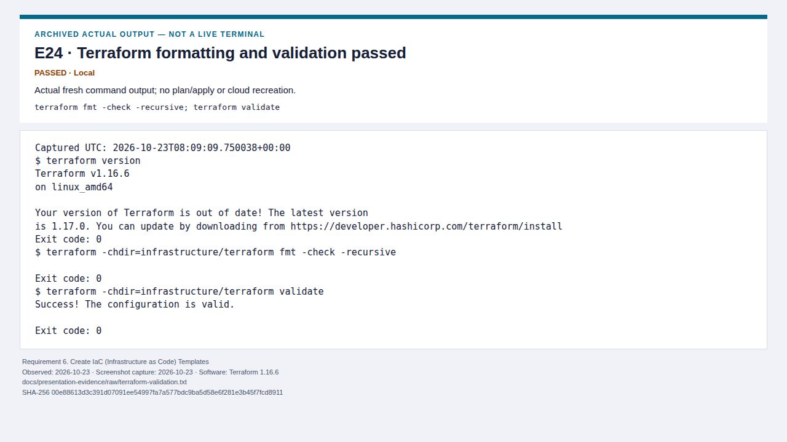
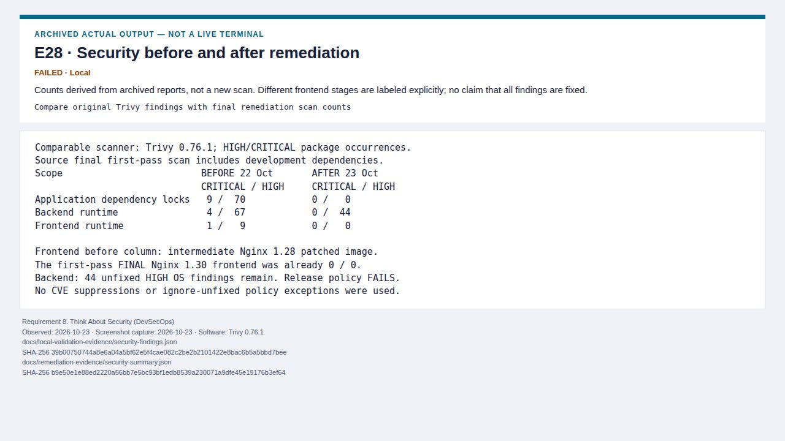
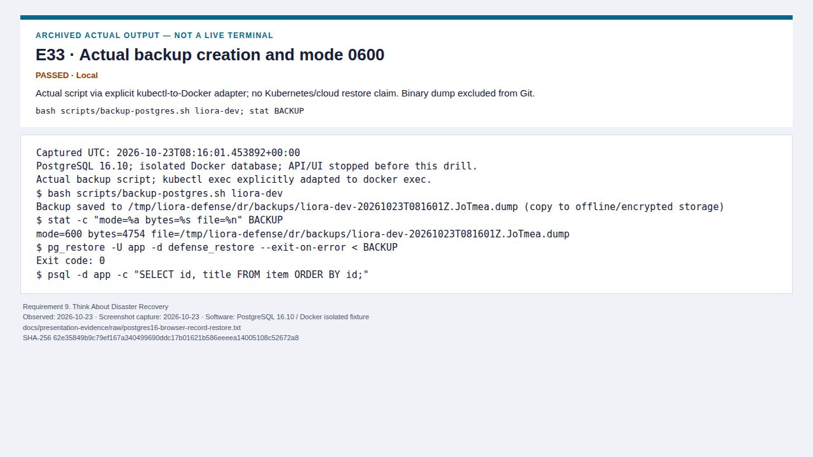
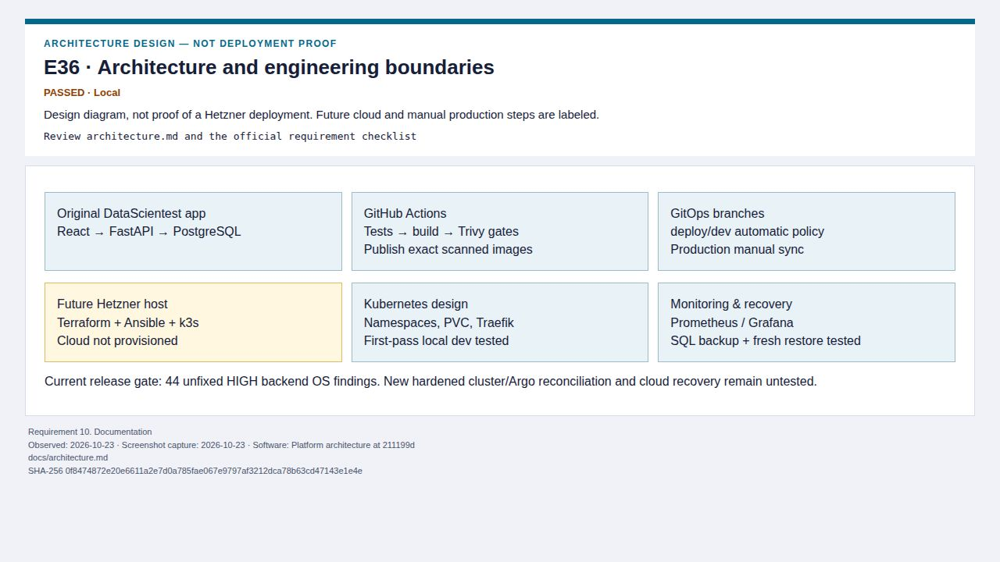

# Graduation presentation evidence

**40 screenshots, covering all ten official requirements:** 12 actual UI captures and 28 clearly labeled views of real saved output/configuration/design. Five earlier UI screenshots are reused unchanged. All captures are dated 2026-10-23; original 2026-10-22 observations are labeled.

Open [the offline gallery](presentation-evidence/index.html) for a screenshot-only presentation, [the complete evidence index](screenshots/README.md) for provenance, and [the final compliance report](final-compliance-report.md) for limitations. Keep the complete `docs/screenshots/` and `docs/presentation-evidence/` directories together. Nothing in the offline gallery needs a live server, credentials or an external CDN.

**State to say aloud:** “The application, tests, local recovery and monitoring have concrete successful evidence. The new Alpine backend passes the local security gate with zero HIGH/CRITICAL findings; the previous Debian failure is preserved as historical evidence. Final hardened Kubernetes/Argo/cloud deployment and full recovery are not yet validated.”

## Ten-minute live demonstration plan

Preflight only services already running safely. Do not start Kubernetes, Argo and monitoring together on the 8 GB laptop. If a page fails, switch to its named screenshot immediately; do not troubleshoot during the timed defense. Commands below are read-only views, not instructions to provision or restore production.

| Time | Explain to the examiner | Live command/page | Screenshot fallback | DevOps skill demonstrated |
| --- | --- | --- | --- | --- | --- |
| 0:00–1:30 | Architecture, original app attribution, IaC boundaries and exact rubric (6, 10). | Architecture.md; `terraform -chdir=infrastructure/terraform validate`; saved Ansible syntax results. | E36, E24, E25 | Reviewed infrastructure code and honest separation of design from execution. |
| 1:30–2:30 | Reproducible Docker packaging and UI–API–database path (1). | `docker ps`; local `/docs`; authenticated Items page, if fixture already running. | E07, E08, E15 | Container runtime verification and a complete functional data path. |
| 2:30–4:00 | Tests, historical publication/promotion and the current gate (3, 5). | [Remediation workflow](https://github.com/dionis1/liora-devops-platform/actions/runs/39920280796); [historical main run](https://github.com/dionis1/liora-devops-platform/actions/runs/39802778100). | E16, E09, E10 | Automated quality checks and controlled publication. |
| 4:00–5:15 | Dev/prod separation, workloads, PVC and ingress (2, 4). | With the explicitly selected disposable context: `kubectl --context CONTEXT -n liora-dev get pods,deploy,sts,svc,pvc,ingress`. Otherwise show static overlays. | E19, E20, E21, E37 | Readiness/storage/routing validation without claiming untested production. |
| 5:15–6:00 | Argo health versus successful synchronization; prod manual policy (5). | `kubectl --context CONTEXT -n argocd get applications`; `gitops/applications.yaml`. | E22, E23, E38 | GitOps policies, failure diagnosis and scope-aware reporting. |
| 6:00–7:15 | Real metrics, target health and alert lifecycle (7). | Local Grafana dashboard/Prometheus targets, only if already running alone. | E03, E04, E05, E26 | Instrumentation and tested alert evaluation/recovery. |
| 7:15–8:45 | Security improvement, remaining failures and enforcement boundaries (8). | Archived scan summaries; [source scan](https://github.com/dionis1/liora-devops-platform/actions/runs/39920280780); new passing Alpine scan versus the historical failed Debian scan. | E39, E40, E28, E29 | Risk reduction with an enforced release gate rather than suppressed findings. |
| 8:45–10:00 | Backup permissions, fresh restore, matching record and recovery limits (9). | Read `raw/postgres16-browser-record-restore.txt`; never restore a real database during the defense. | E33, E34, E35 | Verified recoverability and safe negative-path testing. |

## Ten-minute screenshot-only fallback

Use one minute per official requirement, in this exact order. Open the offline gallery first. Each line supplies the point to explain and the limitation to acknowledge; the requirement sections below give the engineering sentence.

| Time | Official requirement | Show | Say and qualify |
| --- | --- | --- | --- |
| 0:00–1:00 | 1. Dockerize Your Application | [E07: Browser-created item persists after reload](screenshots/01-dockerize-your-application/item-created-and-persisted.jpg), [E15: Running containers and health checks](screenshots/01-dockerize-your-application/E15.jpg) | Actual login/create/reload worked in a small isolated Docker fixture; current hardened images remain unpublished. |
| 1:00–2:00 | 2. Deploy the Application in Multiple Environments (Dev & Prod) | [E19: Dev and prod separation: static manifests](screenshots/02-deploy-the-application-in-multiple-environments-dev-prod/E19.jpg), [E21: Historical PVC and Kubernetes HTTP access](screenshots/04-container-orchestration-with-kubernetes/E21.jpg) | Dev/prod configuration is separated; historical local dev worked, production and final hardening remain untested. |
| 2:00–3:00 | 3. Run Tests on the Application | [E16: 55 upstream tests passed](screenshots/03-run-tests-on-the-application/E16.jpg), [E17: Platform metrics and readiness tests passed](screenshots/03-run-tests-on-the-application/E17.jpg) | 55 upstream plus 2 platform tests passed; full browser E2E/client regeneration was not run. |
| 3:00–4:00 | 4. Container Orchestration with Kubernetes | [E20: Historical dev pods and Services READY](screenshots/04-container-orchestration-with-kubernetes/E20.jpg), [E37: Historical ConfigMap, Ingress and rollout results](screenshots/04-container-orchestration-with-kubernetes/E37.jpg) | Real old dev pods/rollouts/PVC/ingress evidence; these screenshots of saved output are dated, not a current cluster view. |
| 4:00–5:00 | 5. Automate Deployment (CI/CD Pipeline) | [E10: Historical successful GHCR publication and dev promotion](screenshots/05-automate-deployment-ci-cd-pipeline/github-historical-publish-promote.jpg), [E09: Historical Debian CI blocks publication](screenshots/05-automate-deployment-ci-cd-pipeline/github-current-security-gate.jpg) | Older publication/promotion passed; the old Debian gate failed correctly, the new Alpine local gate passes, and successful Argo sync/rollback is unproven. |
| 5:00–6:00 | 6. Create IaC (Infrastructure as Code) Templates | [E24: Terraform formatting and validation passed](screenshots/06-create-iac-infrastructure-as-code-templates/E24.jpg), [E25: Three Ansible syntax checks passed](screenshots/06-create-iac-infrastructure-as-code-templates/E25.jpg) | Templates and syntax validate; no plan/apply, cloud provision or replacement-host test was performed. |
| 6:00–7:00 | 7. Monitor the Application | [E04: Real request counts, error counts and latency](screenshots/07-monitor-the-application/grafana-request-latency-errors.jpg), [E05: Unavailable alert FIRING after one minute](screenshots/07-monitor-the-application/application-alert-firing.jpg) | Synthetic metrics and firing/recovery passed in isolated Docker; ServiceMonitor discovery/notification delivery remains untested. |
| 7:00–8:00 | 8. Think About Security (DevSecOps) | [E39: Alpine scan passes](screenshots/08-think-about-security-devsecops/E39.jpg), [E40: Runtime integration passes](screenshots/08-think-about-security-devsecops/E40.jpg), [E29: Historical Debian failure](screenshots/08-think-about-security-devsecops/E29.jpg) | Backend findings fell from 44 HIGH on Debian to zero HIGH/CRITICAL on Alpine; image integration checks pass. Hosted publication and Kubernetes enforcement remain separate checks. |
| 8:00–9:00 | 9. Think About Disaster Recovery | [E34: Restored record matches the browser-created item](screenshots/09-think-about-disaster-recovery/E34.jpg), [E33: Actual backup creation and mode 0600](screenshots/09-think-about-disaster-recovery/E33.jpg) | Same browser-created ID/title restored into a new PG16 database, with mode 0600; no full cloud/etcd recovery claim. |
| 9:00–10:00 | 10. Documentation | [E36: Architecture and engineering boundaries](screenshots/10-documentation/E36.jpg) | Architecture, provenance, exact rubric and reusable capture protocol make the project reviewable; cloud blocks are future design. |

## Evidence for the ten official requirements

### 1. Dockerize Your Application

**Assessment: PASSED**

**Implemented:** Multi-stage, non-root platform images around the original pinned DataScientest application; digest-pinned Alpine backend, health checks and a reviewed dependency patch.

**How it was tested:** Sequential builds, actual API/database readiness, authenticated browser login, item creation and persistence after reload in a Docker fixture with a temporary same-origin Nginx API proxy. Historical main publication succeeded.

**Evidence:** [E07: Browser-created item persists after reload](screenshots/01-dockerize-your-application/item-created-and-persisted.jpg), [E08: Executed Swagger request returns HTTP 200](screenshots/01-dockerize-your-application/swagger-real-health-200.jpg), [E13: Backend image build completed](screenshots/01-dockerize-your-application/E13.jpg), [E14: Frontend TypeScript and production bundle completed](screenshots/01-dockerize-your-application/E14.jpg), [E15: Running containers and health checks](screenshots/01-dockerize-your-application/E15.jpg), [E10: Historical successful GHCR publication and dev promotion](screenshots/05-automate-deployment-ci-cd-pipeline/github-historical-publish-promote.jpg).

**What to explain:** I can package an existing application reproducibly and validate the complete UI–API–database path.

**Limit:** Publication and authenticated registry pulls for the new Alpine backend are NOT YET TESTED. PR checks do not publish; publication/promotion require a validated push to main. Historical publication evidence is retained.

### 2. Deploy the Application in Multiple Environments (Dev & Prod)

**Assessment: PARTIALLY VALIDATED**

**Implemented:** Separate dev/prod namespaces, overlays, host settings, credentials references and a production TLS Secret reference.

**How it was tested:** Both overlays render; first-pass dev deployment and routing ran locally.

**Evidence:** [E19: Dev and prod separation: static manifests](screenshots/02-deploy-the-application-in-multiple-environments-dev-prod/E19.jpg), [E20: Historical dev pods and Services READY](screenshots/04-container-orchestration-with-kubernetes/E20.jpg), [E21: Historical PVC and Kubernetes HTTP access](screenshots/04-container-orchestration-with-kubernetes/E21.jpg).

**What to explain:** I separate configuration and release policies while being explicit about shared-node failure domains.

**Limit:** Production deployment and public TLS are NOT YET TESTED; final hardened dev manifests were not redeployed.

### 3. Run Tests on the Application

**Assessment: PASSED**

**Implemented:** Upstream tests, PostgreSQL migrations, mypy/Ruff, and metrics/readiness checks run in CI.

**How it was tested:** 55 upstream tests and 2 platform tests pass; exact CI script passes locally and hosted backend-tests/lint jobs passed at 211199d. New browser login/create/reload smoke passed.

**Evidence:** [E16: 55 upstream tests passed](screenshots/03-run-tests-on-the-application/E16.jpg), [E17: Platform metrics and readiness tests passed](screenshots/03-run-tests-on-the-application/E17.jpg), [E18: Mypy and Ruff passed](screenshots/03-run-tests-on-the-application/E18.jpg), [E09: Historical Debian CI blocks publication](screenshots/05-automate-deployment-ci-cd-pipeline/github-current-security-gate.jpg), [E07: Browser-created item persists after reload](screenshots/01-dockerize-your-application/item-created-and-persisted.jpg).

**What to explain:** I use automated checks and a focused functional smoke test to catch compatibility regressions.

**Limit:** The complete automated browser E2E suite and OpenAPI-client regeneration are NOT YET TESTED.

### 4. Container Orchestration with Kubernetes

**Assessment: PARTIALLY VALIDATED**

**Implemented:** Deployments, StatefulSet, PVC, Services, ConfigMap, Ingress, namespace policy and resource/security settings.

**How it was tested:** Historical local dev pods reached 1/1 Ready, PVC Bound, rollouts completed, and frontend/backend/Traefik HTTP routing passed; new manifests render.

**Evidence:** [E20: Historical dev pods and Services READY](screenshots/04-container-orchestration-with-kubernetes/E20.jpg), [E21: Historical PVC and Kubernetes HTTP access](screenshots/04-container-orchestration-with-kubernetes/E21.jpg), [E37: Historical ConfigMap, Ingress and rollout results](screenshots/04-container-orchestration-with-kubernetes/E37.jpg), [E19: Dev and prod separation: static manifests](screenshots/02-deploy-the-application-in-multiple-environments-dev-prod/E19.jpg).

**What to explain:** I translate application dependencies into orchestrated resources and verify readiness, storage and routing.

**Limit:** Historical cluster was deleted. Current hardened cluster, policy enforcement, node-readiness screenshot and cloud deployment are NOT YET TESTED.

### 5. Automate Deployment (CI/CD Pipeline)

**Assessment: PARTIALLY VALIDATED**

**Implemented:** Tests/build/scan gates, exact-scanned-image publication, dev manifest promotion and manual production sync policy; Argo Application manifests.

**How it was tested:** Historical main publication/promotion passed. The Debian scan at 211199d failed with 44 HIGH findings. The new Alpine backend passes the strict local scan with 0 HIGH/CRITICAL and image integration checks; new hosted CI results must be checked separately. Historical Argo installed but private repo comparison FAILED.

**Evidence:** [E09: Historical Debian CI blocks publication](screenshots/05-automate-deployment-ci-cd-pipeline/github-current-security-gate.jpg), [E10: Historical successful GHCR publication and dev promotion](screenshots/05-automate-deployment-ci-cd-pipeline/github-historical-publish-promote.jpg), [E22: Argo CD ran, but private repository comparison failed](screenshots/05-automate-deployment-ci-cd-pipeline/E22.jpg), [E23: Production manual sync configuration](screenshots/05-automate-deployment-ci-cd-pipeline/E23.jpg), [E38: Historical Argo components ready; sync still unproven](screenshots/05-automate-deployment-ci-cd-pipeline/E38.jpg).

**What to explain:** I design a delivery chain that blocks unsafe releases and keep Git promotion distinct from successful deployment.

**Limit:** Successful Argo Synced/Healthy application, public-repo reconciliation and rollback are NOT YET TESTED. The repository became public on 2026-10-23; historical private auth errors do not establish a current public auth failure.

### 6. Create IaC (Infrastructure as Code) Templates

**Assessment: PARTIALLY VALIDATED**

**Implemented:** Terraform Hetzner templates and Ansible preparation/k3s/kubeconfig playbooks, with restricted SSH configuration.

**How it was tested:** Fresh Terraform fmt/validate and three Ansible syntax checks passed; hosted platform validation passed.

**Evidence:** [E24: Terraform formatting and validation passed](screenshots/06-create-iac-infrastructure-as-code-templates/E24.jpg), [E25: Three Ansible syntax checks passed](screenshots/06-create-iac-infrastructure-as-code-templates/E25.jpg), [E11: Current Terraform, Ansible and Kustomize workflow passes](screenshots/06-create-iac-infrastructure-as-code-templates/github-platform-validation-passed.jpg).

**What to explain:** I express infrastructure as reviewed code and validate it before any billable provisioning.

**Limit:** Terraform plan/apply, actual remote provisioning and server recreation are NOT YET TESTED. No Hetzner API resources were created.

### 7. Monitor the Application

**Assessment: PARTIALLY VALIDATED**

**Implemented:** Prometheus/Grafana resources, FastAPI metrics, dashboard, ServiceMonitor and unavailable/5xx alert rules.

**How it was tested:** All three isolated targets were UP including Grafana; real synthetic request/rate/latency/error metrics rendered; the one-minute unavailable alert fired and cleared after recovery.

**Evidence:** [E03: All three Prometheus targets UP](screenshots/07-monitor-the-application/prometheus-targets-up.jpg), [E04: Real request counts, error counts and latency](screenshots/07-monitor-the-application/grafana-request-latency-errors.jpg), [E05: Unavailable alert FIRING after one minute](screenshots/07-monitor-the-application/application-alert-firing.jpg), [E26: Application alert cleared after recovery](screenshots/07-monitor-the-application/E26.jpg), [E27: ServiceMonitor implemented: runtime discovery pending](screenshots/07-monitor-the-application/E27.jpg).

**What to explain:** I instrument service behavior and validate alert evaluation rather than equating process uptime with observability.

**Limit:** The new ServiceMonitor discovery in Kubernetes, receiver delivery, sustained 5xx alert scenario and durable monitoring recovery are NOT YET TESTED.

### 8. Think About Security (DevSecOps)

Latest: [Alpine security remediation and reproducible checks](backend-security-remediation.md), [E39 scan](screenshots/08-think-about-security-devsecops/E39.jpg), [E40 exact-image integration test](screenshots/08-think-about-security-devsecops/E40.jpg). Historical failures below remain dated evidence.

**Assessment: PARTIALLY VALIDATED**

**Implemented:** Dependency remediation, strict source/image gates, non-root/read-only controls, dropped capabilities, NetworkPolicies and safe temporary credential cleanup.

**How it was tested:** Patched locks including dev dependencies and frontend runtime: 0 HIGH/CRITICAL. Backend progressed from 4 critical/67 high to Debian 0 critical/44 high, then Alpine 0 critical/0 high in the new strict local scan. The rebuilt image passed migrations, login, authenticated CRUD, readiness and metrics with non-root/read-only restrictions. Historical failing hosted evidence is preserved.

**Evidence:** [E28: Security before and after remediation](screenshots/08-think-about-security-devsecops/E28.jpg), [E29: Historical Debian security gate fails closed](screenshots/08-think-about-security-devsecops/E29.jpg), [E12: Current source security workflow passes](screenshots/08-think-about-security-devsecops/github-source-security-passed.jpg), [E30: Container security controls configured](screenshots/08-think-about-security-devsecops/E30.jpg), [E31: Default-deny policy and explicit database traffic](screenshots/08-think-about-security-devsecops/E31.jpg), [E32: Temporary credential access removed](screenshots/08-think-about-security-devsecops/E32.jpg).

**What to explain:** I quantify security improvement, keep failing policy checks enabled, and distinguish configuration from enforcement.

**Limit:** Fresh hosted CI validation and publication for this change must be checked separately. Live Kubernetes NetworkPolicy enforcement remains NOT YET TESTED; public HTTPS repository access needs no deploy key. The temporary account SSH key was removed.

### 9. Think About Disaster Recovery

**Assessment: PARTIALLY VALIDATED**

**Implemented:** Atomic compressed PostgreSQL backups, recovery/rollback runbooks and off-node snapshot/token guidance.

**How it was tested:** PG16 backup mode 0600, fresh database restore, same browser-created item ID/title, and failed-dump cleanup passed; previous three-row restore also passed.

**Evidence:** [E33: Actual backup creation and mode 0600](screenshots/09-think-about-disaster-recovery/E33.jpg), [E34: Restored record matches the browser-created item](screenshots/09-think-about-disaster-recovery/E34.jpg), [E35: Failed backups leave no completed corrupt archive](screenshots/09-think-about-disaster-recovery/E35.jpg), [E07: Browser-created item persists after reload](screenshots/01-dockerize-your-application/item-created-and-persisted.jpg).

**What to explain:** I prove recovery with restored data and failure-path checks while stating the boundary of the drill.

**Limit:** GitOps/deployment rollback, actual k3s snapshot/restore, off-site durability and replacement-server recovery are NOT YET TESTED. The kubectl-to-Docker adapter is documented explicitly.

### 10. Documentation

**Assessment: PASSED**

**Implemented:** Architecture/runbooks, exact ten-heading compliance mapping, provenance-backed screenshot index, capture protocol and both ten-minute plans.

**How it was tested:** Screenshot/source hashes, original-image preservation, asset links and offline presentation gallery are checked before delivery.

**Evidence:** [E36: Architecture and engineering boundaries](screenshots/10-documentation/E36.jpg).

**What to explain:** I make the system reviewable and explain its tested capabilities and remaining risks precisely.

**Limit:** The architecture is a design view; future cloud boxes are not deployment evidence. This is an evidence pack, not an exported PowerPoint deck.

## Before the defense

1. Copy the complete offline evidence pack to a second disk and test it with network disconnected.
2. Keep the main screenshot folder and manifest together; do not relabel old runs as current.
3. Rehearse the eight-step live plan once and the exact ten-step fallback once with a ten-minute timer.
4. Use test-only data, hide credentials and leave the failing release gate visible.
5. Any remaining validation must follow the [capture-before-cleanup protocol](screenshots/capture-protocol.md).
